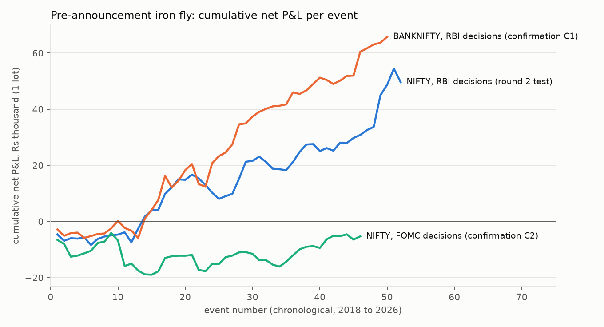

# nifty-options-lab

A research and execution stack for NIFTY index options: free NSE data turned into clean option
chains, a cost-aware backtester with walk-forward validation and multiple-testing corrections, and
an Upstox execution layer with paper trading, risk checks and a trade journal.

The research question was whether a small retail account (Rs 1 to 2 lakh) can find a repeatable,
defensible edge in NIFTY options after Indian costs. The short answer, from 359 pre-registered
variants: **the volatility premium is real but mostly eaten by costs at one-lot size; one
event-driven candidate (selling premium in the quiet sessions before RBI decisions) has consistent
evidence but does not clear every test.** The full write-up with every number, including the
failures, is in [`reports/RESULTS.md`](reports/RESULTS.md).

> Nothing in this repository is investment advice. Options can lose money quickly; past backtest
> results do not predict future returns. The execution layer ships disabled and in paper mode.

## Results at a glance

| Hypothesis | Verdict |
|---|---|
| Weekly short-volatility structures held to expiry (320 variants) | Fail: gross edge 2 to 2.4 bps, costs take most of it; walk-forward out-of-sample t = -0.09 |
| Trend-filtered monthly put spread | Fail |
| Long straddle before RBI decisions | Fail, significantly negative (t = -4.4) |
| Overnight short straddle | Profitable before costs, not after (replicates Bhat, Pandey and Rao 2024) |
| Last-half-hour futures momentum | No signal |
| **RBI pre-announcement iron fly** | **Passes 5 of 6 tests**, replicates on BANKNIFTY (t = 3.0), not around FOMC |



## Data

| Source | What | Access |
|---|---|---|
| NSE F&O bhavcopy (legacy and UDiFF formats) | Every NIFTY and BANKNIFTY option and future, daily OHLC, settlement, volume, OI, 2018 onward | Free, no account |
| Upstox historical candles v3 | NIFTY, BANKNIFTY, India VIX daily (2008 onward) and one-minute (2022 onward) | Free, no token for index candles |
| Event calendar (`configs/events.yaml`) | RBI MPC, Union Budget, election results, FOMC | From the RBI, Ministry of Finance, ECI and Fed sites |

Pipeline, each layer rebuilt from the one before:

```text
data/raw/nse_fo/YYYY/YYYYMMDD.csv.zip      files exactly as NSE publishes them
data/processed/fo_bhav/year=YYYY/          one schema for both formats; untraded rows flagged
data/processed/chain/{SYMBOL}/year=YYYY/   forward, Black-76 IV and delta, sessions to expiry, lot size
data/processed/features/                   realised vol, HAR-X forecasts, ATM IV, trend, event flags
data/optlab.duckdb                         DuckDB views over all of it (`optlab sql "..."`)
```

Data hygiene that matters for the results:

* **Stale prices.** Legacy bhavcopies carry a close for contracts that did not trade. Those rows are
  flagged and never filled against; a structure with any untraded leg is skipped, not partly filled.
* **Holiday expiries.** When expiry falls on a holiday NSE moves it a session earlier, but legacy
  files keep the scheduled date. Expiries are mapped to the session they actually settled on.
* **Lot sizes** changed five times for NIFTY since 2018 and old and new lots traded side by side;
  the lot comes from the contract record or, for old files, from the circular schedule by expiry.
* **Look-ahead.** Features on date t use data to t's close; the HAR model refits on an expanding
  window; walk-forward selection only sees trades that had settled before the decision date.
* **Costs by date.** STT, exchange charges, SEBI fee, stamp duty and GST at the rates in force on
  each trade date (STT on option sales went 0.05%, 0.0625%, 0.1%, 0.15% between 2018 and 2026).

## Quick start

```bash
python -m venv .venv && source .venv/bin/activate     # Windows: .venv\Scripts\activate
pip install -e ".[dev]"

optlab data fetch          # about 40 minutes the first time (NSE asks for polite request rates)
optlab data build          # Parquet layers, chains, features
optlab data check          # data-quality report
optlab research            # round 1: all pre-registered hypotheses
python -m optlab.research.round2
python -m optlab.research.confirm
optlab sql "select expiry, settlement from read_parquet('data/processed/settlements_NIFTY.parquet') order by expiry desc limit 5"
```

## Execution

```bash
cp .env.example .env              # Upstox API key and secret
optlab live login                 # prints the login URL; you sign in and paste the code back
optlab live run --dry-run         # decide and journal, place nothing
optlab live run --mode paper      # real quotes, simulated fills
```

`optlab live run` is meant to be scheduled for 15:15 IST on trading days (cron, Windows Task
Scheduler, or `docker compose run --rm runner`). On an RBI entry day it builds the iron fly from live
quotes with the same leg logic as the backtest, checks the maximum loss against the risk budget and
the available margin, and works limit orders from mid to touch, long legs first, unwinding if any
leg fails. On the exit day it closes the position, or leaves it to cash settle if it expires that
day. A file named `journal/KILL` stops all trading.

Rules this follows: limit orders only (market orders over the API are blocked); orders must come
from the static IP registered with Upstox (SEBI retail algo framework, in force from 1 April 2026);
well under the 10 orders per second threshold; daily login.

## Layout

```text
src/optlab/
  data/         NSE and Upstox downloaders, Parquet layers, chains, features, quality checks, DuckDB
  market/       lot sizes, dated cost schedule, Black-76 pricing and IV, realised vol and HAR
  backtest/     chain book, trade simulation, metrics (deflated Sharpe, PBO, bootstrap), walk-forward
  strategies/   short-vol structures, put spread, event straddles, event premium, futures momentum
  research/     pre-registered runners and figures
  execution/    broker interface, Upstox client, paper broker, order working, runner, journal
configs/        event calendar, deployed strategy
docs/           research plan (written before results), costs, data notes
reports/        RESULTS.md, summaries, figures (trade-level files are rebuilt, not committed)
tests/          unit tests, offline
```

## Licence

MIT.
