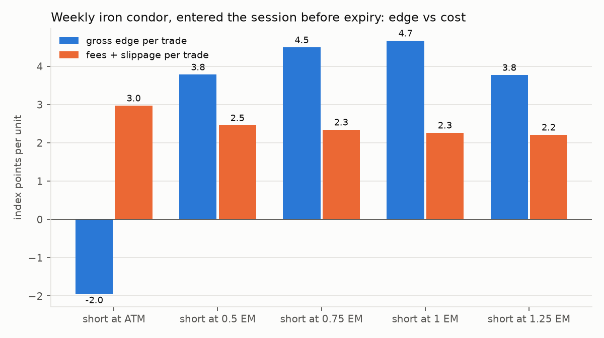

# Results

Data: NSE F&O bhavcopy, 1 Jan 2018 to 16 Oct 2026 (2,178 sessions, 4.6 million NIFTY option
contract-days, 3.1 million BANKNIFTY); NIFTY and India VIX daily from 2008 and one-minute from 2022.
Costs at the rates in force on each date, Upstox brokerage, slippage as specified in
`docs/research_plan.md`. One lot, Rs 1.5 lakh account. Everything below is reproducible with
`optlab data build && optlab research && python -m optlab.research.round2 && python -m optlab.research.confirm`.

Nothing here is investment advice or a promise of future returns. Backtests on end-of-day data are
estimates; live fills, costs and market rules will differ.

## Summary

| Round | Hypothesis | Verdict |
|---|---|---|
| 1 | H1 weekly short-volatility structures held to expiry (320 variants) | **Fail.** Best in-sample t = 1.65; walk-forward out-of-sample mean -Rs 55 per trade (t = -0.09); PBO 0.54 |
| 1 | H2 trend-filtered monthly put spread (12 variants) | **Fail.** All t < 0.6; single-trade losses up to Rs 46,000 |
| 1 | H3 long straddle before RBI decisions and Budgets (9 variants) | **Fail, and significantly negative** (t = -4.4 for T-2 to T-1). Led to round 2 |
| 1 | H4 close-to-open short straddle | **Fail after costs** (t = -2.8); positive before costs, replicating Bhat, Pandey and Rao (2024) |
| 1 | H5 last-half-hour momentum, NIFTY futures (3 variants) | **Fail.** No signal before costs (t = 0.6) |
| 2 | R2a pre-RBI iron fly, wings 3 EM, T-2 close to T-1 close | **Passes 5 of 6 tests**; fails the deflated Sharpe test |
| 2 | C1 same rule on BANKNIFTY (confirmation) | **Replicates**: +Rs 1,316 per event, t = 3.0 |
| 2 | C2 same rule around FOMC (confirmation) | **Does not replicate**: -Rs 114 per event, t = -0.3 |

**Bottom line.** No strategy cleared every pre-registered test. The one candidate with consistent
evidence is the RBI pre-announcement iron fly: positive on NIFTY, replicated on BANKNIFTY over the
same decision dates, better than a placebo on ordinary days, positive before and after the November
2024 rule changes, and still positive at twice the assumed slippage. It fails the deflated Sharpe
test (about 6 events a year cannot overcome 359 tried variants) and it does not carry over to FOMC
decisions. It is deployed **in paper mode** with `enabled: false` until a live record exists.

## Round 1

### H1: the variance risk premium after costs

The premium exists and sits in the wings, not at the money. For condors entered at the close of the
session before expiry, the gross edge is 3.8 to 4.7 index points per trade (about 2 to 2.4 basis
points of the index), and fees plus slippage take 2.2 to 2.5 points. Selling the ATM iron fly loses
even before costs (gross -2.0 points, t = -2.2): expiry-eve ATM options are not overpriced; retail
demand concentrates in out-of-the-money strikes.

The net edge that remains is not distinguishable from zero:

| Variant (in-sample, full period) | Trades | Mean net Rs | t | Hit rate | Worst Rs |
|---|---|---|---|---|---|
| Entry 1 session before expiry, shorts 1 EM, wings 1 EM, VRP > 1.15 | 304 | 258 | 1.65 | 77% | -12,844 |
| Same, no filter | 414 | 162 | 1.22 | 77% | -12,844 |
| Entry 3 sessions before (Thursday to Tuesday), shorts 1 EM | 411 | 27 | 0.11 | 71% | -29,945 |
| Iron fly (ATM shorts), entry 1 session before | 414 | -393 | -4.72 | 32% | -3,417 |

None of the 320 variants reaches t = 2 in-sample. The walk-forward selection (best trailing 3-year
variant chosen every six months, from 2021) produced 61 out-of-sample trades with mean -Rs 55
(bootstrap 95% interval -Rs 907 to +Rs 801), deflated Sharpe probability 0.05, and a probability of
backtest overfitting of 0.54: choosing the best variant on the past was no better than chance.

Why: about half the per-trade cost is the flat Rs 20 per order (four orders, plus GST) spread over a
single lot. When the NIFTY lot was 25 (May 2024 to Jan 2025), brokerage alone was 3.8 points per
trade, more than the whole gross edge. The economics improve with size, which this account does not
have.

BANKNIFTY context: the volatility-filtered weekly condors were strongly positive on BANKNIFTY
weeklies (for example entry 2 sessions before expiry, shorts 1.25 EM, VRP > 1.3: 166 trades, +Rs 844,
t = 4.8), consistent with a larger retail premium in that contract. BANKNIFTY weeklies were
discontinued in November 2024, so this cannot be traded now.

### H2 to H5

* **H2** (monthly put spread, trend filter): best variant +Rs 661 per trade, t = 0.50; worst single
  trade -Rs 46,017. Rejected.
* **H3** (long ATM straddle before events): T-2 to T-1 before RBI decisions lost on 41 of 54 events,
  mean -Rs 1,523, t = -4.4. Time decay over the two quiet sessions outweighs any rise in implied
  volatility.
* **H4** (sell the ATM straddle at the close, buy back at the next open): gross +0.94 points per trade,
  net -Rs 196 (t = -2.8) over 2,177 trades. Replicates the published finding that the overnight
  premium does not survive costs.
* **H5** (last-half-hour futures momentum, 2022 to 2026): gross +0.66 points per trade (t = 0.6);
  after STT, charges and slippage, -Rs 439 per trade. No signal.

## Round 2: the pre-announcement premium

Hypothesis, fixed before running (see `docs/research_plan.md`): realised volatility is subdued in
the sessions just before a scheduled policy announcement while implied volatility carries the event
("calm before the storm": Jones, Lamont and Lumsdaine 1998; Bomfim 2003; Shaikh and Padhi 2013 for
India VIX). Selling ATM premium two sessions before an RBI decision and closing before the
announcement should earn more than the same trade on ordinary days.

| Variant | Events | Mean Rs | t | 95% CI | Placebo mean Rs | Diff t | Pre/post Nov 2024 mean Rs | 2x slippage mean Rs |
|---|---|---|---|---|---|---|---|---|
| Iron fly, wings 1 EM, T-2 to T-1 | 54 | -236 | -0.84 | -726 to 282 | -395 | 0.56 | -229 / -258 | -393 |
| Iron fly, wings 2 EM, T-2 to T-1 | 53 | 649 | 1.71 | -79 to 1,401 | -296 | 2.44 | 384 / 1,553 | 511 |
| **Iron fly, wings 3 EM, T-2 to T-1** | **52** | **956** | **2.32** | **158 to 1,744** | **-212** | **2.75** | **639 / 2,138** | **829** |
| Same, RBI + Budget | 63 | 670 | 1.75 | -111 to 1,452 | -212 | 2.22 | 326 / 1,992 | 524 |
| Naked straddle, T-2 to T-1 (reference, needs more margin than the account) | 54 | 1,338 | 2.99 | 375 to 2,271 | -13 | 2.92 | 847 / 3,053 | n/a |
| Iron fly held through the announcement (T-1 to T) | 54 | -650 | -2.27 | -1,122 to -197 | -395 | -0.88 | | |

Tests on the 3 EM variant: positive mean with the bootstrap interval above zero (pass); beats the
placebo, t = 2.75 (pass); positive in both regimes (pass); survives 2x slippage (pass); the worst 5%
of events erase 15% of the gains (pass); deflated Sharpe probability 0.25 at 359 trials (fail).
Holding through the announcement loses: the premium is earned in the quiet sessions, not from the
implied-vol crush.

Confirmation on samples the rule was not chosen on, rule frozen:

| Test | Events | Mean Rs | t | 95% CI | Hit rate |
|---|---|---|---|---|---|
| C1 BANKNIFTY, RBI decisions | 50 | 1,316 | 3.04 | 547 to 2,051 | 76% |
| C2 NIFTY, FOMC decisions | 46 | -114 | -0.31 | -833 to 579 | 61% |
| Pooled, return on risk | 96 | 2.7% | 2.00 | 0.3% to 5.0% | |

The pre-registered confirmation rule required both C1 and C2 to be positive, so confirmation fails as
written. The pattern is specific to RBI decisions, which land during Indian market hours; FOMC
decisions arrive overnight and the Indian sessions before them show no comparable lull. C1 shares
its event dates with the NIFTY test, so it confirms that the effect is not a NIFTY quirk, but it is
not an independent sample of events.

Year by year (3 EM, NIFTY): 2018 -Rs 5,652; 2019 +1,837; 2020 +13,708; 2021 +3,156; 2022 +8,583;
2023 -404; 2024 +4,029; 2025 +7,353; 2026 to date +17,094. Seven of nine years positive on both
indices.

Scale: about 6 trades a year; capital is at risk for two sessions per event; median maximum loss per
lot about Rs 21,000. At one lot the backtest averaged roughly Rs 5,700 a year on NIFTY. That is a
small, lumpy return with real losing years, not an income stream.

## What would change the verdict

* A live or paper record of 12 or more RBI decisions with results inside the backtest's range.
* Intraday option data (Upstox Plus, Groww or Dhan; loaders in `src/optlab/data/`) to replace the
  end-of-day close fills with time-stamped quotes and measure real spreads.
* Larger size, where the flat brokerage matters less; the H1 premium may then clear costs.

## Known limitations

* No bid-ask quotes: slippage is an assumption, stress-tested at 2x and 3x.
* Close prices are NSE's last-half-hour weighted prices; a 15:20 order will fill near, not at, them.
* Weekly NIFTY options start in February 2019; 2018 tests use the monthly expiry.
* The event study has about 54 events; one surprising decision moves the averages noticeably.
